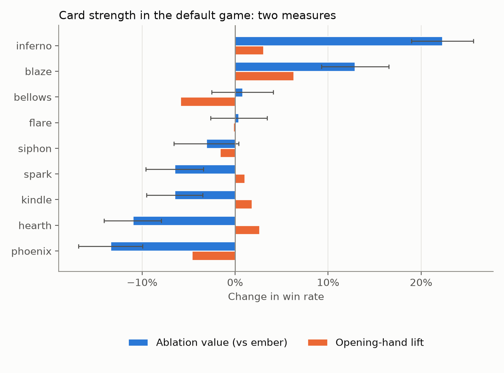
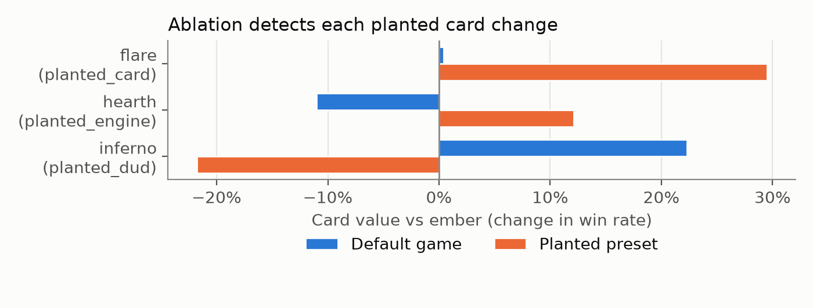
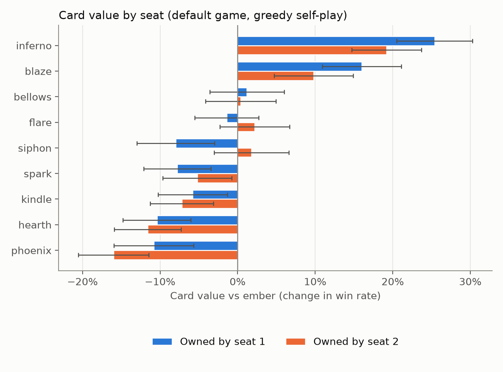
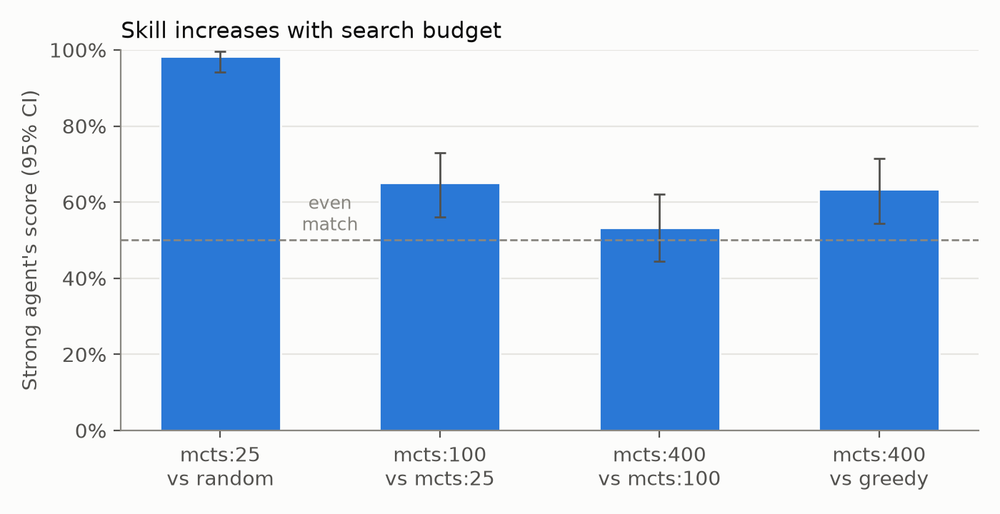
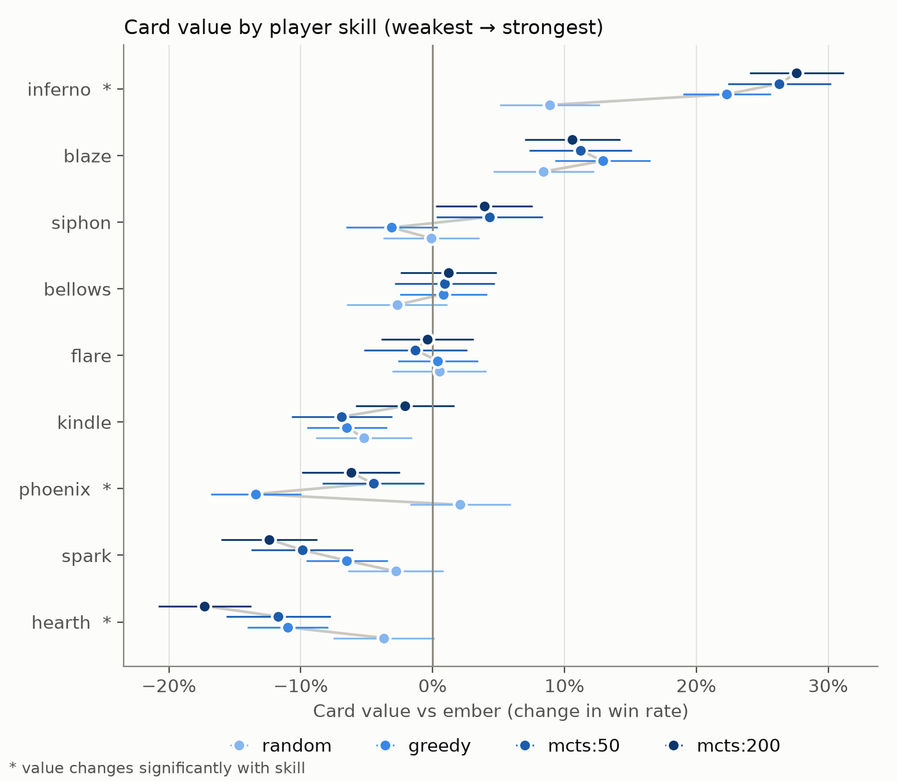
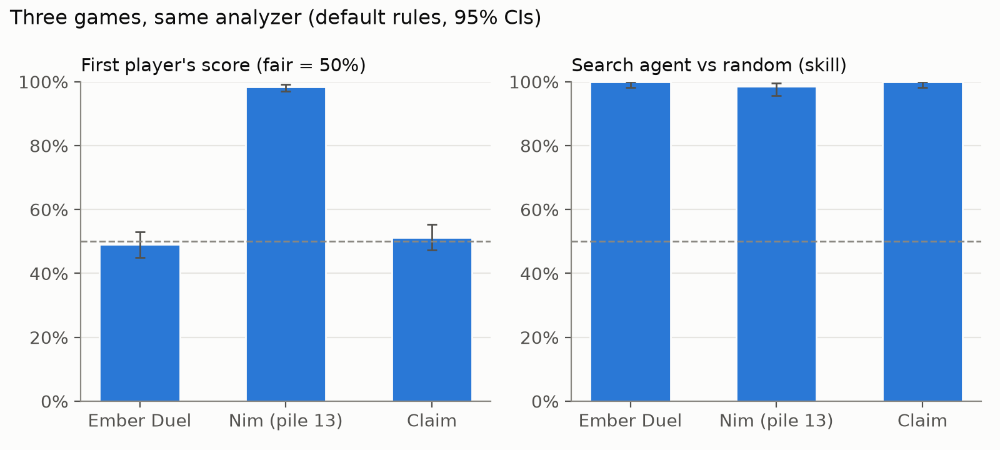

# Automated Playtesting and Balance Tuning

[](https://github.com/nandgudearya-sketch/project-AI-/actions/workflows/tests.yml)

**Team:** Karan Manish Shah, Nidhi Nimmagadda, Arya Atul Nandgude

Foundations of AI project (Khoury College, Northeastern). The tool plays a game
thousands of times with AI agents of different skill levels, reports balance
problems, searches for dominant strategies, and proposes parameter changes that
it then verifies by further simulation.

Pure Python 3.10+, standard library only. No installation needed.

```bash
git clone https://github.com/nandgudearya-sketch/project-AI-.git
cd project-AI-
pip install -e .                          # optional: adds a `balancer` command
python -m unittest discover tests         # 32 tests, ~2 min
python -m balancer list                   # games, presets, tunable parameters
python -m balancer simulate --preset planted_card
python -m balancer evaluate               # the full evaluation (~3 min on 1 core)
```

## Web demo

```bash
python -m balancer web
```

This opens http://127.0.0.1:8000 in your browser, with two tabs:

- **Play:** play Ember Duel against the AI at three difficulties (Easy = random,
  Medium = greedy, Hard = MCTS with 300 simulations per move), going first or
  second, on the balanced game or any planted version. The page only ever
  receives your own hand and the opponent's card count, never their cards.
- **Balance lab:** run the analyzer on any version of the game and see the
  findings, first-player advantage with its confidence interval, card
  strength, and game length. Use at least 2,000 games.

It uses only the Python standard library and runs your real engine and agents.
Options: `--port 8080`, `--no-browser`, `--workers 4`. Press Ctrl+C to stop.

**Demo script:** in Balance lab, run "Balanced (default)" to show a clean
report, then "Planted: overpowered Flare" to show the tool flagging Flare.
Switch to Play, choose Hard, and play a few turns against MCTS.

The **Claim: new game →** link (or http://127.0.0.1:8000/games) opens a second
page for my new game, Claim, with three tabs: **Play** Claim against the AI,
**Balance lab** for any of the three games, and **Compare games**, the saved
results of `python -m balancer compare`. A step-by-step presentation script is
in [docs/PRESENTATION.md](docs/PRESENTATION.md).

## Project layout

```
balancer/
  core/game.py            The abstract Game interface. Everything else only uses this.
  games/
    ember.py              Ember Duel: our original card game (main test case + planted imbalances)
    nim.py                Subtraction Nim: second game proving the engine is general
    pig.py                Pig Race: push-your-luck dice game (luck, no hidden hand)
    grid.py               Claim: a perfect-information board game
    __init__.py           Game registry
  agents/
    simple.py             random, greedy (turn planner), weighted (strategy), human
    mcts.py               Single-observer Information Set MCTS (handles hidden cards)
    __init__.py           make_agent("mcts:200") etc.
  sim/harness.py          Parallel simulation, seat swapping, seeded records
  analysis/balance.py     Balance report: seat advantage, card strength, dead cards,
                          game length, skill-vs-luck; Wilson confidence intervals
  analysis/ablation.py    Card ablation: whole-game card value, split by seat
  search/strategy.py      Dominant-strategy search: card-focus probe + genetic algorithm
  tune/tuner.py           Hill-climbing tuner with common random numbers and held-out verification
  evaluation/suite.py     The proposal's three evaluation claims, as runnable experiments
  evaluation/figures.py   Report charts (PNG + CSV) in docs/figures/; needs matplotlib
  evaluation/compare.py   Same checks on every game, side by side (`balancer compare`)
  web/                    Browser front end: server.py (JSON API) + static/index.html
                          games_api.py + static/games.html: the Claim page
  __main__.py             Command-line interface
tests/test_balancer.py, tests/test_games.py
docs/figures/             Generated report figures and the numbers behind them
main.py                   Shortcut: `python main.py <command>`, or a quick tour with no command
```

## How the pieces fit

1. **Game interface** (`core/game.py`). A game provides `initial_state(seed)`,
   `legal_actions`, `step` (in place), `clone`, `is_terminal`, `winner`, and
   optionally `determinize` (re-deal hidden cards), `heuristic`, and analytics
   hooks (`action_label`, `opening_labels`). All tunable numbers live in a flat
   `params` dict, so the tuner never needs game-specific code. All randomness is
   fixed by the seed when the state is created, so `step` is deterministic and
   every game is reproducible.
2. **Agents.** `random`; `greedy`, which plans its whole turn against the game
   heuristic; `mcts:N`, ISMCTS with N iterations per move (skill scales with
   N); `weighted:...`, a greedy planner biased toward or away from particular
   cards (the strategy space the search explores); and `human`.
3. **Harness.** Games run in a duplicate format: games 2k and 2k+1 use the same
   seed with seats swapped. This cancels deal luck when comparing agents and
   gives common random numbers for tuning.
4. **Analyzer.** Every rate comes with a 95% Wilson interval, and issues are
   flagged only when the interval clears a practical-significance margin.
5. **Search and tuning** reuse the harness and analyzer.

## Ember Duel rules

Each player has a 20-card deck (2 copies of 10 cards). Each turn you gain
energy equal to your turn number (max 8), score your growth, draw a card, then
play any affordable cards. First to 40 points wins; after 40 total turns the
higher score wins. The second player starts with 4 points and 1 extra card as
compensation. Cards score points, draw cards, give energy, steal points, or
add growth (points every turn). Every number is a parameter: `python -m balancer list`.

## Pig Race rules

Two players alternate turns. On your turn, `roll` a die (a 1 busts: you lose
your turn points and the turn ends; anything else adds to your turn points) or
`hold` to bank them. Reaching `target` (50) wins at once; after `max_turns`
turns the higher score wins. Going first is an edge, so the second player gets
`p2_start_points` as compensation (0 by default, which gives seat 1 about 53%;
4 brings it to about 48%). Presets: `compensated`, `planted_p2_edge`,
`planted_short`, `planted_timeout`. Use `mcts:N` agents: greedy's turn planner
judges the state before a turn-ending action, which suits Ember but not Pig.

```bash
python -m balancer simulate --game pig --preset compensated --agents mcts:100 mcts:100 --games 1000
```

## Commands

```bash
# Balance report (add --luck for a skill-vs-luck check, --json out.json to save)
python -m balancer simulate --agents mcts:100 greedy --games 500
python -m balancer simulate --set flare.cost=2 target_points=35

# Card ablation: swap each card for a reference card on the same seeds
python -m balancer ablate --preset planted_card --reference ember --seeds 500

# Dominant-strategy search
python -m balancer probe  --preset planted_engine          # favour-one-card strategies vs greedy
python -m balancer search --opponents greedy mcts:50       # genetic algorithm

# Propose and verify fixes
python -m balancer tune --preset planted_card --params flare.cost flare.points

# Play against an agent (for the "agents play reasonably vs humans" evaluation)
python -m balancer play --opponent mcts:200

# Report figures (pip install matplotlib first; ~1 min)
python -m balancer figures

# Does card value depend on skill? (~15 min with mcts:200; weakest agent first)
python -m balancer ablate --skill random greedy mcts:50 mcts:200 --figure docs/figures
```

Agent specs: `random`, `greedy`, `mcts:N`, `weighted:spark=0.5;siphon=-1`, `human`.

## Measuring card strength: why opening-hand lift

The obvious metric, win rate when a card is *played*, is badly confounded. For
example, inferno costs 7, so only players who survive to turn 7 can play it.
In one run it showed a 61.5% "win when played" rate while actually being
slightly *negative* to start with. The analyzer instead compares players who
had a card in their **opening hand** with those who did not. The shuffle
decides that, so the comparison is a randomized experiment and the lift is a
causal estimate of how much the card helps. The played-win-rate column is
still shown, but only as descriptive data.

## Evaluation results (from `python -m balancer evaluate`)

**1. Planted imbalances** (2,000 greedy self-play games each): 6/6 pass.

| Preset | Planted change | Expected flag | Result |
|---|---|---|---|
| default | none (control) | nothing | PASS, no flags |
| planted_seat | second player loses compensation | seat advantage (first) | PASS |
| planted_card | flare cost 3→1, points 4→6 | flare dominant | PASS |
| planted_engine | hearth cost 4→2 | hearth dominant | PASS |
| planted_dud | inferno cost 7→10 | inferno dead | PASS |
| planted_long | target 40→200 | games time out | PASS |

The dud and long presets also produce secondary findings (a second-player
advantage, growth becoming dominant). These are real consequences of the
change, not false positives: in a long game, a points-per-turn engine really
does take over.

**2. Agents play reasonably.**

| Match | Strong agent's score | 95% CI |
|---|---|---|
| mcts:25 vs random | 98.3% | 94.1–99.5% |
| mcts:100 vs mcts:25 | 65.0% | 56.1–72.9% |
| mcts:400 vs mcts:100 | 53.3% | 44.4–62.0% |
| mcts:400 vs greedy | 63.3% | 54.4–71.4% |

Skill increases with search budget, with diminishing returns past about 100
iterations (worth discussing in the report). In Nim, strong self-play recovers
the theoretical result: the first player wins 100% at pile 13 and 0% at pile 12
(a multiple of 4). The human-play side of this claim still needs your own
playtest sessions via `python -m balancer play`.

**3. Before/after tuning.** Starting from planted_seat (seat 1 wins 79.9%), the
tuner proposed `p2_start_points 0→3, p2_extra_cards 0→3`. On 3,000 fresh-seed
games, seat 1's score dropped to 47.2% (CI 45.4–49.0%) and flagged issues went
from 1 to 0. A different run proposed `0→3, 0→2` and reached 51.9%. Results
vary slightly because the tuner trains on 600 games; the held-out check is what
makes the claim trustworthy. On planted_card it proposed `flare.points 6→3`,
reducing flare's lift from 10.2% to 6.7%.

**4. Card ablation detects planted card changes** (500 paired seeds per card
and seat, greedy self-play). A card's ablation value is relative to the
reference card (`ember`), so each planted card is compared with the same card
in the default game: 3/3 pass.

| Preset | Card | Value in default game | Value in planted game | z | Result |
|---|---|---|---|---|---|
| planted_card | flare | +0.4% | +29.5% (rank 1 of 9) | +12.9 | PASS |
| planted_engine | hearth | −11.0% | +12.1% (rank 2 of 9) | +10.5 | PASS |
| planted_dud | inferno | +22.3% | −21.8% (rank 9 of 9) | −19.6 | PASS |

### Figures

Generated by `python -m balancer figures`; each PNG has a CSV with the same
numbers next to it in `docs/figures/`.



Ablation and opening-hand lift disagree most on expensive cards: `inferno` is
worth +22% by ablation but only +3% by lift, because a 7-cost card in the
opening hand does nothing for the first six turns. `hearth`, `kindle` and
`spark` go the other way: mildly positive by lift but negative by ablation,
meaning that over a whole game a plain 2-cost, 3-point `ember` serves the
greedy player better.





No card is flagged as seat-dependent in the default game. The biggest gap is
`siphon` (−8% for seat 1, +2% for seat 2, gap z = −2.8, just under the
flagging threshold of 3), a candidate for a closer look with more seeds.



**5. Card value depends on skill.** The same ablation, run once per agent with
that agent in both seats (500 paired seeds per card and seat for each agent).
A card is flagged when its value differs between two agents by more than 10
points with |z| > 3.

| Card | random | greedy | mcts:50 | mcts:200 |
|---|---|---|---|---|
| inferno * | +8.9% | +22.3% | +26.3% | +27.6% |
| blaze | +8.4% | +12.9% | +11.2% | +10.6% |
| siphon | −0.1% | −3.1% | +4.3% | +3.9% |
| bellows | −2.7% | +0.8% | +0.9% | +1.2% |
| flare | +0.5% | +0.4% | −1.3% | −0.4% |
| kindle | −5.2% | −6.5% | −6.9% | −2.1% |
| phoenix * | +2.1% | −13.4% | −4.5% | −6.2% |
| spark | −2.8% | −6.5% | −9.9% | −12.4% |
| hearth * | −3.7% | −11.0% | −11.7% | −17.3% |



What this means for a designer:

- **`inferno` rewards skill.** It is worth +9% to a random player but +28% to
  MCTS-200 (z = +7.0). A 7-cost finisher only pays off for players who plan
  their energy toward it, so playtests with beginners would underrate it.
- **`hearth` gets worse as skill rises** (−4% → −17%, z = −5.1), and `spark`
  follows the same trend. A likely reason: against a weak opponent a slow
  points-per-turn engine has time to pay off, while strong opponents end the
  game before it does.
  To a beginner the card may feel fine, while experts should avoid it.
- **`phoenix` exposes the greedy heuristic.** It is worth −13% to greedy but
  only −5% to −6% to MCTS. Search plays it much better than the one-turn
  heuristic does, so greedy-only balance reports misjudge it. This is the
  same kind of mispricing the strategy search looks for.
- Most cards (`blaze`, `bellows`, `flare`, `kindle`, `siphon`) keep roughly the
  same value at every skill level, so the greedy-agent results earlier in this
  README are a fair guide for them.

**6. One tool, three games** (`python -m balancer compare`). The same agents and
analyzer, with no game-specific analysis code, on three very different games:

| Game | Type | First player (default rules) | Skill: MCTS-100 vs random | Planted problem | Found? |
|---|---|---|---|---|---|
| Ember Duel | card game, hidden hands | 49.0% (45–53%) | 100% | Flare too cheap → `dominant: flare` | PASS |
| Nim | perfect information, solved | 98.3% at pile 13 ✓ theory | 98.5% | pile 12 → `seat: second` (theory) | PASS |
| Claim | perfect-information board | 51.3% (47–55%) | 100% | no second-player bonus → `seat: first` (73.8%) | PASS |



Nim uses MCTS-1000 and piles 13 and 12, where that agent plays perfectly; on
the default pile of 21 even MCTS-1000 still makes mistakes, so its answer there
would not match theory. Ember and Claim use MCTS-50 self-play.

### New game: Claim

A 4×4 board; each square shows a number from 1 to 5, dealt from the seed.
Players take turns claiming a square and score its number plus 1 for each of
their own squares next to it. When the board is full the higher score wins.
There is no hidden information and no luck after the deal, so the only balance
question is move order.

- **Tuning the compensation.** With no bonus the first player wins 75% (MCTS-50).
  A 2-point head start for the second player brings it to 51.3% (MCTS-50) and
  50.2% (MCTS-100), so 2 is the default.
- **Balance depends on skill here too.** With the same 2-point bonus, the greedy
  agent (one move ahead) gives the *second* player the edge: the first player
  scores only 38%. The right compensation depends on how well people play.
- Presets: `planted_seat` (no bonus) and `planted_snowball` (neighbour bonus 4).

## Design decisions worth explaining in your report

- **Noise is the central problem.** Simulation results are random, so
  every comparison uses fixed seeds (common random numbers), duplicate seat
  swapping, confidence intervals, and a final check on held-out seeds. The
  tuner reports "NOT VERIFIED" if an improvement doesn't survive fresh seeds.
- **Balance depends on skill.** A card can be strong for experts and useless
  for beginners. Run `simulate` with several agent pairs and report results
  per skill level, and `ablate --skill` to measure each card's value per skill
  level (result 5 above). Always use the same agent in both seats when
  measuring seat advantage.
- **Strategies are defined relative to greedy.** Weighted agents are greedy
  plus per-card preferences, so all-zero weights equals greedy and 50% is the
  fair baseline. A strategy that beats greedy has found a card the heuristic
  misprices.
- **MCTS tuning.** Long random rollouts in a card game are mostly noise. Ember
  uses 6-move rollouts with an informed policy, then the heuristic
  (`rollout_depth`, `mcts_c` on the game class). Nim has no heuristic, so it
  rolls out to the end.

## Adding a second game

1. Create `balancer/games/yourgame.py` and subclass `Game`. Set `name`,
   `DEFAULT_PARAMS`, `PARAM_SPACE` (integer bounds for tunables) and `PRESETS`,
   and implement the abstract methods. See `nim.py` for a minimal example,
   `grid.py` (Claim) for a board game with a heuristic, and `ember.py` for
   hidden information.
2. Register it in `balancer/games/__init__.py`.
3. For hidden information, implement `determinize`. For card or action
   statistics, implement `all_action_labels`, `action_label` and
   `opening_labels`. For better MCTS, provide `heuristic` and set
   `rollout_depth`.

Everything else (agents, reports, search, tuning, CLI) then works unchanged.

## Limitations and next steps

- Opening-hand lift measures early-game impact; late-game cards can look weaker
  than they are. `balancer ablate` addresses this: it replaces one player's
  copies of a card with a reference card, replays the same seeds, and averages
  the paired win-rate differences. In greedy self-play on the default game it
  rates `inferno` the strongest card (+22% over `ember`), while its
  opening-hand lift is only about +3%. Values are relative to the reference
  card, so pick a reference you consider fair. Ablation measures value for one
  agent (greedy here); repeat it with `--agent mcts:100` to see whether card
  value changes with skill.
- MCTS beats greedy only moderately in this simple race game. Better heuristics,
  more iterations, or ISMCTS with opponent modelling are natural extensions.
- The tuner is (1+λ) hill climbing. CMA-ES or a GA over parameters, or
  Bayesian optimization, would scale better to many parameters.
- Opening-hand lifts are pooled over both seats. The ablation report splits
  card value by seat and flags cards that are much stronger going first or
  second (`[seat_card]`).

## Suggested team split

- **Agents** (`agents/`): MCTS improvements, human playtest sessions.
- **Analysis** (`analysis/`, `evaluation/`): metrics, planted cases, report figures.
- **Search and tuning** (`search/`, `tune/`): GA/probe, tuner, and verification experiments.
